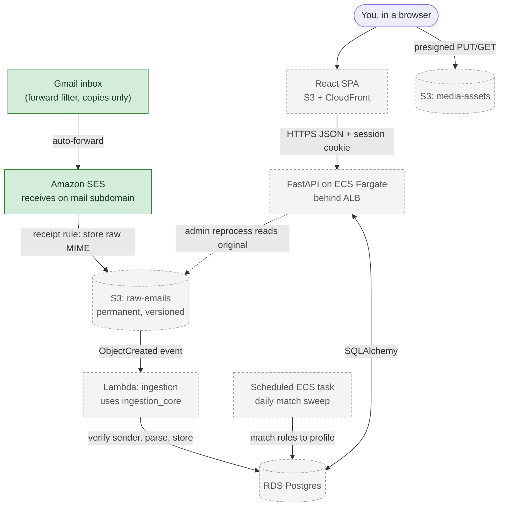

# my-castings

A personal casting-call aggregator for actors. Backstage and Casting Networks already email
digest alerts ("here are N new roles for you"); this project turns those emails into a
structured feed of roles, matches each role against a single artist profile (playing age,
gender, location), and tracks what you've saved, applied to, or dismissed.

Single-user v1. Built on AWS end to end, with a typed API, a pluggable parser per casting
source, and infrastructure as code.

## Status

| Phase | Scope | State |
|---|---|---|
| 0 | Prove a sender's DKIM survives the Gmail-forward → SES hop | ✅ Done: 32/32 forwarded digests passed |
| 1a | Local skeleton: parsers, schema, matching, API, seed (no AWS) | ✅ Done |
| 1e | Casting Networks parser | ✅ Done |
| — | Actors Access parser | 🟡 Provisional: built from a manual forward, awaiting an auto-forwarded email |
| 1b | AWS infrastructure (CDK) + deploy the API | 🟡 All stacks written and tested; only `Guardrails` deployed |
| 1c | React frontend, media uploads (presigned S3) | ✅ Done locally (media on a local S3 stand-in); hosting comes with 1b |
| 1d | Wire the live email pipeline (S3 → Lambda → RDS) | 🟡 Written and tested locally (real Lambda image); not deployed |

### Implemented so far

- **Email parsing (`packages/ingestion_core`)**
  - Backstage and Casting Networks digest parsers, built and tested against real
    forwarded emails. Casting Networks sends one card per role; the parser groups them
    back into one posting per project and reads each role's submission deadline.
  - Actors Access parser (provisional): one posting per breakdown, with type, union
    status, location, gender and age.
  - Pay, as the source prints it, for Backstage and Casting Networks roles.
  - Sender verification from SES's `Authentication-Results` header. Only the topmost,
    SES-written header is trusted, and a sender counts as verified only on an aligned
    DKIM or SPF pass.
  - Adapter registry that refuses to guess when two parsers claim the same sender.
- **Database:** Postgres schema with Alembic migrations for sources, raw emails, casting
  calls, roles, artist profile, media assets, and saved matches.
- **Ingestion:** one entry point (`ingest()`): verify the sender, pick the parser, parse,
  store.
  - Emails from unverified senders are quarantined and store nothing.
  - Reprocessing an email updates rows in place, so saved, applied and dismissed state
    survives a re-parse.
- **Matching**
  - Rule-based: the role's age range overlaps the profile's playing range, genders
    overlap, and the location matches or the artist is willing to travel.
  - Each match stores the reason for every rule.
- **Match sweep:** creates `new` matches and re-evaluates untouched ones after profile
  edits. It never changes a match you've acted on.
- **API (FastAPI)**
  - Single-password login: scrypt hash, JWT session cookie, rate-limited.
  - Endpoints for profile, casting calls, matches, and admin (needs-attention list and
    reprocess). Matches can be filtered by status, source, project type and a text
    search, sorted by deadline, match date or posting date, and summarized as counts
    per status.
- **Frontend (`apps/web`, React)**
  - Login page and a matches dashboard: one card per matched role with source, project
    type, ages, location, pay and deadline, and a New / Saved / Applied / Dismissed
    control per card.
  - Status tiles with counts (click to show or hide a status), source and project-type
    filters, search, and sorting. Filters live in the URL, so a refresh keeps the view.
  - Casting-call page: description, every role with its apply link, status and a note.
  - Profile page (saving re-runs matching) and a "Needs attention" page listing failed,
    partial and unverified emails, with reprocessing.
  - Media library: headshots, modeling digitals, acting reels, self-tapes, resume PDF and
    social links. Files upload straight from the browser to S3 through signed forms
    that pin type and size; reels and self-tapes can also be links. Items are marked
    current or archived, and a sweep cleans up uploads that never finished.
- **Tests:** about 350 tests covering parsers, verification, migrations, reconciliation,
  matching, sweeps, auth, every endpoint (media against an in-memory S3), and every
  page (Vitest).

**Not built yet:** CI/CD. Everything else is written; on AWS only the cost budget is
deployed so far.

## Architecture



Green parts are live today: SES receiving and the Gmail forward from Phase 0 (delivering
to a scratch bucket). Dashed parts are planned AWS resources. Their application code
(ingestion, matching, sweep, API) already runs locally against Docker Postgres.

**How one email flows through the system**

1. Gmail forwards a digest to SES.
2. SES stores the raw email in S3. It is kept forever, whatever happens to parsing.
3. The S3 event triggers the Lambda, which calls `ingest()`:
   - It checks the topmost `Authentication-Results` header for an aligned DKIM pass.
   - It picks the parser for that sender.
   - It writes `casting_calls` and `roles`, and records `parse_status`.
4. The match sweep compares new roles with the artist profile and records `saved_matches`.
5. The SPA shows matches. Failures and quarantined emails appear in the admin view, where
   they can be reprocessed once a parser is fixed.

## Tech stack

| Area | Choice |
|---|---|
| Language | Python 3.12, managed with [uv](https://docs.astral.sh/uv/) workspaces |
| API | FastAPI, Pydantic v2, pydantic-settings |
| Database | PostgreSQL 16, SQLAlchemy 2, Alembic, psycopg 3 |
| Email parsing | stdlib `email`, BeautifulSoup + lxml |
| Auth | scrypt (stdlib `hashlib`), PyJWT session cookie |
| Testing / lint | pytest, FastAPI TestClient, ruff |
| Local infra | Docker Compose: Postgres, and RustFS as an S3-compatible stand-in for media |
| AWS (planned) | SES, S3, Lambda, RDS, ECS Fargate + ALB, CloudFront, EventBridge, SSM, Route 53, all defined in CDK (Python) |
| Frontend | React 19 + TypeScript, Vite, React Router, TanStack Query, CSS modules; Vitest + Testing Library |
| CI/CD (planned) | GitHub Actions with OIDC deploy role |

## Repository layout

```
my-castings/
├── pyproject.toml              uv workspace root: members, shared dev tools, pytest/ruff config
├── docker-compose.yml          local Postgres (dev db + my_castings_test) and RustFS (media)
├── docker/postgres-init.sql    creates the test database
├── infra/                      AWS CDK app (Python): every AWS resource as code
│   ├── app.py                  entry point; stacks pinned to us-east-1, cdk-nag checks
│   ├── my_castings_infra/      one module per stack: guardrails, network, data, app, web
│   ├── tests/                  CDK assertion tests (and the CloudFront functions, run in Node)
│   └── package.json            pins the CDK CLI (`npx cdk ...`)
├── scripts/aws/                create_app_secrets, run_migration, deploy_web, backfill_emails
├── Dockerfile                  the API image (also runs migrations and the daily sweep)
│
├── packages/ingestion_core/    pure-Python parsing, no DB or AWS; shared by API and Lambda
│   ├── ingestion_core/
│   │   ├── types.py            ParsedDigest / ParsedPosting / ParsedRole (parser output)
│   │   ├── verification.py     sender check from SES's Authentication-Results header
│   │   ├── adapters/
│   │   │   ├── base.py         CastingSourceAdapter interface: one class per source
│   │   │   ├── backstage.py    Backstage digest parser
│   │   │   ├── casting_networks.py  Casting Networks digest parser
│   │   │   ├── actors_access.py     Actors Access notification parser (provisional)
│   │   │   └── registry.py     sender -> adapter (none / one / ambiguous)
│   │   └── parsing/            MIME helpers, "Posted 2 days ago" parsing, text/gender/
│   │                           age/location normalization
│   └── tests/
│       └── fixtures/           real post-forward .eml captures (Backstage, Casting Networks)
│
└── apps/
    ├── web/                    React frontend (Vite); /api is proxied to the API in dev
    │   └── src/
    │       ├── api/            fetch client + one module per resource, types mirroring schemas
    │       ├── components/     layout/ (header, protected route), matches/ (card, filters, tiles)
    │       ├── pages/          Login, Dashboard, CastingCall, Profile, Media, Admin
    │       ├── hooks/          useUpdateMatch (optimistic status/note changes)
    │       ├── test/           fake API, render helper, fixtures
    │       └── lib/            URL filter state, formatting, source colors
    ├── api/                    FastAPI backend
    │   ├── alembic/versions/   schema migrations (source of truth for the DB)
    │   ├── app/
    │   │   ├── main.py         app factory, router wiring, /health
    │   │   ├── config.py       settings from MY_CASTINGS_* env vars / .env
    │   │   ├── deps.py         DB session + session-cookie auth dependencies
    │   │   ├── models/         SQLAlchemy tables (status state machines documented inline)
    │   │   ├── schemas/        Pydantic request/response models
    │   │   ├── routers/        auth, profile, casting_calls, matches, media, admin
    │   │   ├── services/
    │   │   │   ├── ingestion.py        ingest() + store_digest() (in-place reconciliation)
    │   │   │   ├── matching.py         age / gender / location criteria
    │   │   │   ├── sweeps.py           match sweep and media (stale upload) sweep
    │   │   │   ├── media.py            what each media type accepts
    │   │   │   ├── media_store.py      S3: signed upload forms and view links
    │   │   │   ├── profile.py          single-row profile get/upsert
    │   │   │   ├── auth.py             password hashing, JWT, login rate limiter
    │   │   │   └── raw_email_store.py  fetch original email (local dir now, S3 later)
    │   │   ├── seed.py         local data: replay fixtures, create profile, run sweep
    │   │   └── sweeps.py       scheduled-task CLI: python -m app.sweeps run_once
    │   ├── tests/              DB-backed tests (run against my_castings_test)
    │   └── .env.example        local settings template
    │                           (the ingestion Lambda is apps/api/app/ingest_lambda.py, built
    │                           from the same Dockerfile with --target lambda)
```

**Where information lives**

| What | Where |
|---|---|
| Original emails | S3 `raw-emails` in production; `packages/ingestion_core/tests/fixtures/` locally (`s3_bucket='local'`) |
| Parse outcome per email | `raw_emails`: `parse_status`, `parse_error`, `sender_verified`, `verdict_details` |
| Postings and roles | `casting_calls`, `roles` (the Apply URL is stored exactly as received and is personal to your account) |
| Artist profile | `artist_profile` (one row; playing age range, gender labels, location, willing to travel) |
| Matches and your actions | `saved_matches`: `status` new/saved/applied/dismissed, `match_reasons`, `user_note` |
| Which sources exist | `casting_sources`, seeded by migration; each row pairs with an adapter's `source_key` |
| Secrets | `apps/api/.env` locally (git-ignored); SSM Parameter Store in production |

## Local setup

**Prerequisites:** [uv](https://docs.astral.sh/uv/getting-started/installation/) and
Docker Desktop. uv installs Python 3.12 itself.

```bash
# 1. Install dependencies (creates .venv)
uv sync

# 2. Start Postgres (also creates the my_castings_test database) and local S3 storage
docker compose up -d --wait

# 3. Configure the API
cd apps/api
cp .env.example .env
uv run python -m app.services.auth      # enter a password; paste the output into
                                        # MY_CASTINGS_AUTH_PASSWORD_HASH in .env
python3 -c "import secrets; print(secrets.token_urlsafe(48))"
                                        # paste into MY_CASTINGS_JWT_SECRET

# 4. Create the schema
uv run alembic upgrade head

# 5. Load sample data: parses the fixture emails, creates the profile, computes matches
uv run python -m app.seed

# 5b. Create the local media bucket and allow uploads from the dev frontend
uv run python -m app.media_setup

# 6. Run the API
uv run uvicorn app.main:app --reload

# 7. In another terminal, run the frontend (Node 24: `nvm use` reads apps/web/.nvmrc)
cd apps/web
npm install
npm run dev
```

The app is at <http://localhost:5173>; log in with the password from step 3.

The API is now at <http://localhost:8000>, with interactive docs at
<http://localhost:8000/docs>. To try it from the terminal:

```bash
curl -c /tmp/mc.txt -H 'content-type: application/json' \
     -d '{"password":"<your password>"}' localhost:8000/auth/login
curl -b /tmp/mc.txt localhost:8000/matches
```

### Everyday commands

Run from the repository root unless noted.

| Task | Command |
|---|---|
| Run all tests | `uv run pytest`, plus `cd apps/web && npm test` for the frontend |
| Frontend checks | `cd apps/web && npm run typecheck && npm run lint && npm run format:check && npm run build` |
| Lint / format | `uv run ruff check .` and `uv run ruff format .` |
| New migration after editing models | `cd apps/api && uv run alembic revision --autogenerate -m "..."`, then review the file. Autogenerate misses CHECK constraints and data moves. |
| Check models match migrations | `cd apps/api && uv run alembic check` |
| Re-run the match sweep | `cd apps/api && uv run python -m app.sweeps run_once` |
| Reset local data | `docker compose down -v && docker compose up -d --wait`, then repeat steps 4–5 |

The seed and the sweep are idempotent. Re-running them reprocesses emails in place and
never duplicates matches or overwrites a profile you've edited.

### AWS infrastructure (CDK)

One-time setup: `cd infra && npm install`, and put your AWS account id and the budget
alert address in your user-level CDK settings (both kept out of the repo):

```json
// ~/.cdk.json
{
  "context": {
    "aws_account_id": "123456789012",
    "budget_alert_email": "you@example.com",
    "origin_verify_secret": "<random: python3 -c 'import secrets; print(secrets.token_urlsafe(32))'>"
  }
}
```

Stacks avoid CDK context lookups (availability zones are named in code), so there is no
`cdk.context.json`; it is git-ignored because its keys would include the account id.

| Task | Command (from `infra/`) |
|---|---|
| Synthesize templates and run cdk-nag | `npx cdk synth --strict` |
| Preview a change | `npx cdk diff <Stack>` |
| Deploy | `npx cdk deploy <Stack>` (always after reading the diff) |
| Infra tests | `uv run pytest infra/tests` (from the repo root) |

Deployed so far: `Guardrails` (a $100/month cost budget emailing at 50/80/100% of actual
spend and 100% forecast; termination protection on).

#### The stacks

| Stack | What | About per month |
|---|---|---|
| `Guardrails` | cost budget and alerts | free |
| `Network` | VPC across 2 AZs, 1 NAT gateway, S3 gateway endpoint, security groups | ~$37 |
| `Data` | Postgres 16 (t4g.micro, single-AZ, 7-day backups, deletion protection), raw-email and media buckets; termination-protected, everything retained | ~$15 |
| `App` | the API on Fargate (ARM, 0.25 vCPU) behind a load balancer that accepts only CloudFront; migrate and daily-sweep tasks | ~$25 |
| `Web` | CloudFront at the domain: the frontend from a private bucket, `/api/*` to the load balancer | ~$1 |
| `Ingestion` | SES rule to the raw-email bucket, EventBridge, the parsing Lambda, a dead-letter queue that emails an alert | ~free |

The browser only ever talks to `https://allcastings.fyi`; CloudFront sends `/api/*` to
the load balancer (`origin.allcastings.fyi`) with a secret header, and the load balancer
answers 403 to anything without it.

#### First deploy (and the order for a rebuild)

Needs Docker running (the API image is built for ARM during `cdk deploy App`).

```bash
uv run python scripts/aws/create_app_secrets.py   # login password (hidden) + session key
cd infra
npx cdk deploy Network Data                       # the database takes ~10 minutes
npx cdk deploy App                                # builds and pushes the API image
cd ..
uv run python scripts/aws/run_migration.py        # create the schema (before Ingestion!)
cd infra && npx cdk deploy Ingestion Web && cd .. # CloudFront takes ~5-10 minutes
uv run python scripts/aws/deploy_web.py           # build and publish the frontend
uv run python scripts/aws/backfill_emails.py      # import past emails from the scratch bucket
```

Then log in at https://allcastings.fyi, fill in your profile (matches are computed when
you save it), and confirm the alert subscription email AWS sends to your budget address.

#### Releasing changes

| Changed | Do |
|---|---|
| API code | `run_migration.py` first if there's a new migration, then `npx cdk deploy App Ingestion` (both run the same code) |
| Frontend | `uv run python scripts/aws/deploy_web.py` |
| Login password | `uv run python scripts/aws/create_app_secrets.py --replace`, then redeploy `App` |

## Design notes

The full plan lives outside the repo. Key decisions so far:

- **DKIM is what verifies a sender.** SPF also passes after Gmail forwarding, but for
  Gmail's rewritten envelope domain, so it is never aligned and never counts.
- **Reprocessing updates rows in place, never delete-and-replace.** Roles are matched by
  (name, occurrence). A failed re-parse never deletes data, and roles you acted on are
  kept even if a re-parse no longer finds them.
- **Missing profile data fails a match rule rather than passing it.** Unmatched roles are
  re-checked on every sweep, so they match once the profile is complete. Passing instead
  would create permanent false matches.
- **Ages are playing ranges, so matching is by overlap.** A 16–30 playing range fits an
  18–24 role and an `18+` role.
